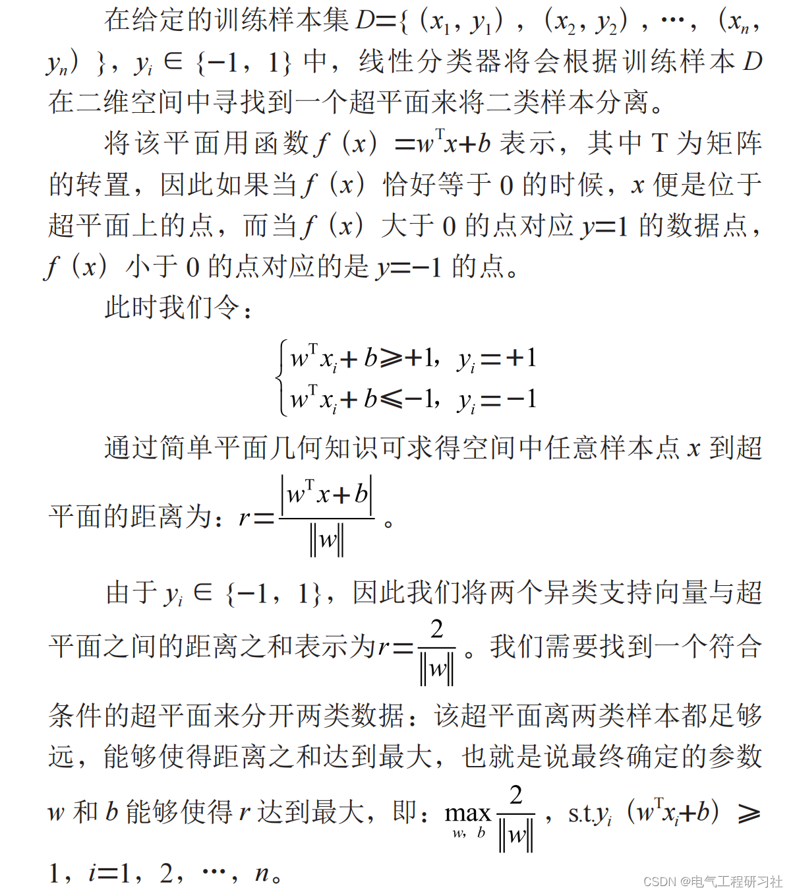
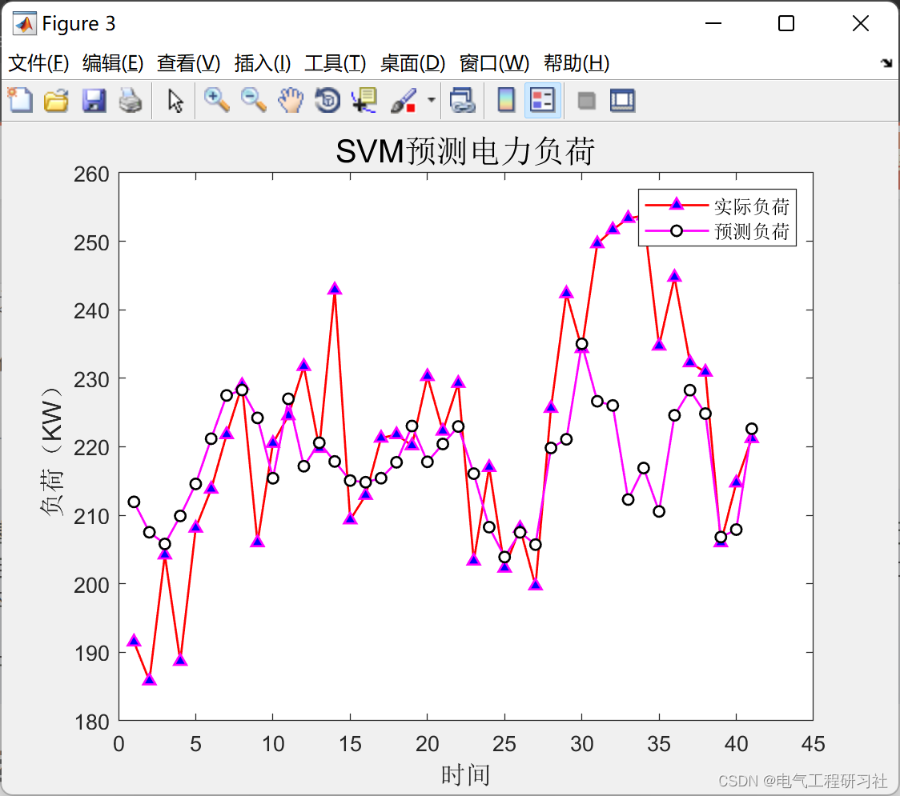
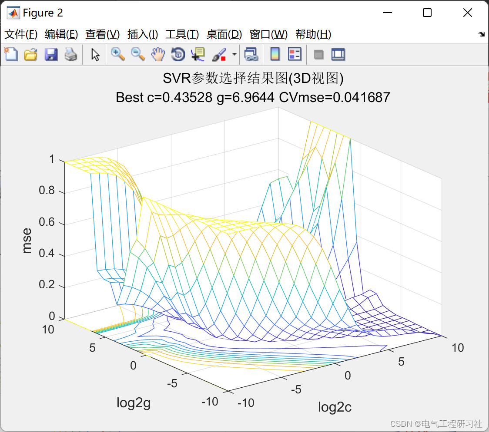
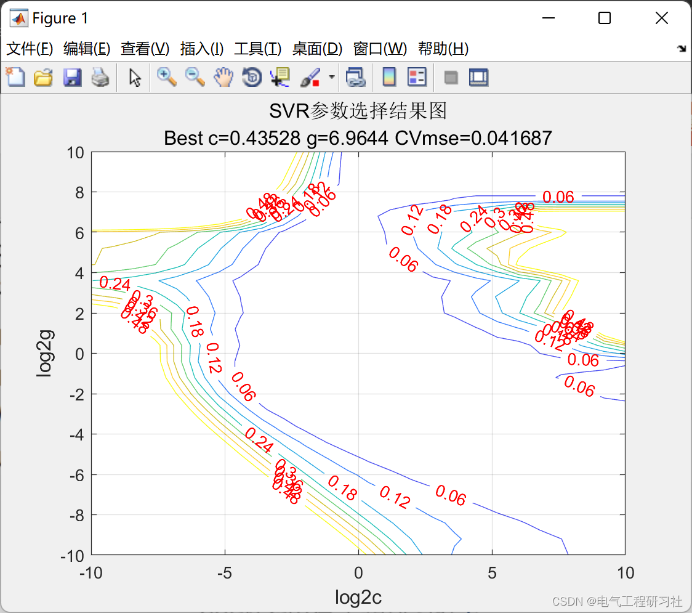
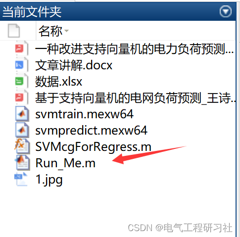

# Load Forecasting | Research on an Improved Support Vector Machine for Electricity Load Forecasting (Matlab Code Implementation)

1. Overview
Load forecasting is a prediction or estimation of future load based on historical load data, which is an important component in the planning and operation of power systems and a pressing issue in the field of power systems research [1]. Power load forecasting is a crucial task for power departments, providing important decision-making basis for grid expansion, power dispatch, etc. With the deep development of smart grids, the increasing number of electric vehicle charging stations, distributed generators, etc., has increased the instability of the electric side of the smart grid, leading to fluctuations in the power system and uncertainty in power loads; at the same time, power loads are also affected by meteorological factors (temperature, humidity, etc.), holidays, industrial areas conditions, unforeseen events, and management and policy impacts, undoubtedly increasing the difficulty of load forecasting. Therefore, adopting appropriate forecasting techniques and scientifically and accurately predicting the trend of power loads is of great significance.
Based on existing power load forecasting methods, this paper proposes a power load forecasting model based on Support Vector Machine (SVM). Firstly, it analyzes the theoretical foundation of SVM and establishes an SVM forecasting model by inputting preprocessed real power data into the model for learning and prediction. The model's predictive performance is verified and analyzed through mean square error (RMSE), average absolute percentage error (MAPE), and prediction charts. Experimental results show that the SVM forecasting model can accurately depict power load forecasting.
2. Support Vector Machine Algorithm
The above is the basic idea of the SVM model under the condition of linear separation. As for the regression model part, the optimization objective function is consistent with the classification model, but the constraints differ. The purpose of the regression model is to make all sample points in the training set fit as closely as possible to the same linear model. For more detailed explanation, see Section 4.
3. Examples and Operation Results
​
4. Matlab code and article detailed reading. This article only displays a part of the code, all codes can be found in:  
Edit
% Clear environment variables\nclose all;\nclear all;\nclc;\nformat compact;\n%% Data Extraction and Preprocessing\ndata=xlsread('Data');\nts =  data((1:320),1);% Training set output\ntsx = data((1:320),2:end);% Training set input\ntts=data((321:end),1);% Prediction set output\nttx= data((321:end),2:end);%Prediction set input\n% Data preprocessing, normalize the raw data.\nts = ts';\ntsx = tsx';\ntts=tts';\nttx=ttx';\n\n% mapminmax is a built-in mapping function in MATLAB.\n% Normalize ts\n[TS,TSps] = mapminmax(ts,-1,1);\t% Vector normalization\n[TTS,TTSps]= mapminmax(tts,-1,1);\nTS = TS';\nTTS=TTS';\n  
5 Conclusions: Upon analyzing the results in Figure 1 and Table 1, it can be observed that:
(1) The SVM model performs well in predicting power loads, accurately capturing the trend of power loads over a certain period.
(2) It is challenging to grasp the peak changes in power loads during specific periods, and the model tends to stabilize when predicting peak loads, resulting in low accuracy in predicting power loads under extreme conditions. This is because in real-world electricity usage scenarios, power loads are not only related to time but also influenced by numerous other factors.
6 References: [1] He Lufeng, Huang Ying. Research on an improved support vector machine method for power load prediction [J]. Hongshuihe, 2022, 41(02):94-99.
[2] Wang Shihan, Zhou Fanguo. Power load prediction based on support vector machines [J]. Modern Information Technology, 2020, 4(24):120-122. DOI: 10.19850/j.cnki.2096-4706.2020.24.032.
7 End Notes

## Images

<!-- PAYMENT_BLOCK -->

## Get this dataset

- Payment link (Stripe): [Buy now](https://buy.stripe.com/3cs8yP7sY87d0vu9AB)
- Payment QR code: 

<!-- /PAYMENT_BLOCK -->
